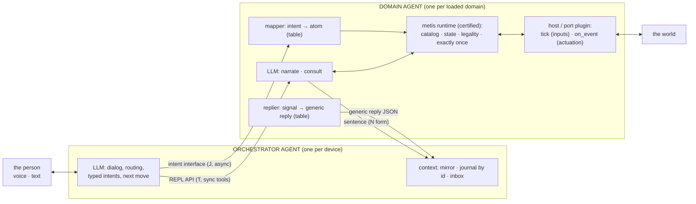

# metis-agent: a small LLM supervising a certified runtime

Oct 13, 2026 · v3 (architect, with the user) — the agentic model: two agents and one kernel, their interfaces, and the single-model optimization kept apart. v2 (Oct 10) rewrote `System design.md`
(@Chief's seed, kept beside this file as the source), verified
against metis as it stands (metispy e375d9c, metis-lang 8bbfd9d,
metis-loop 50e709c). Companion: `runtime-answers.md` answers the
seed's open questions mechanism by mechanism; this document folds
the answers in and marks every part EXISTS or GAP.


## Vocabulary (replaces the fast/slow framing)

The two-system psychology metaphor is dropped: metis is slow next to
an algorithm and fast next to LLM inference, so "fast/slow" points
at different sides depending on the ruler. The split that matters is
authority, not speed:

- **The certified side** — the metis runtime: owns state, procedure,
  probability and safety; every behavior admitted through gates;
  ~10 ms per evaluation; always on; never waits for the model.
- **The proposing side** — a small local LLM: narrates, maps a
  request to one typed intent, proposes explanations for surprises,
  describes escalations. Fallible by assumption; checked before
  every effect; narrow authority, revocable to zero (observe-only
  never depends on it).

Improvements ship as catalog changes through the revision loop,
never as weights. A deployed device gets smarter without retraining
its model.


## Roles

| Concern | Owner | The LLM's part |
| --- | --- | --- |
| State over a long run | Runtime | Reads a mirror of it |
| Step-by-step procedure | Domain rules | Picks which domain applies |
| Uncertainty | Runtime, exact inference | Puts the result into words |
| Safety and legality | Orchestrator agent; observe-only on surprise | None; cannot override |
| When to think | Orchestrator signals | Wakes when signalled |
| Changing the rules | Revision loop, offline, human-approved | Describes what went wrong |
| Language and intent | Orchestrator agent | One typed intent per request |
| Understanding a domain | Domain agent | Narrates it; answers questions about it |
| Judging a surprise | Domain agent proposes, runtime checks | Suggests which card explains it |
| The dialog with the person | Orchestrator agent | Speaks; asks; keeps the floor |

## Architecture: two agents and one kernel

The design is stated for **two agents on two models**. That is the
architecture. Running both on one small model with context switching is an
optimization, described apart (below, "Running it on one small model"), and
it changes none of the interfaces here.



One kernel serves both: the runtime inside every domain agent is the same
certified interpreter; the orchestrator never touches it directly. The line
between the two agents is drawn by **who has to understand the domain**:
atoms, events, bindings and ports are the domain agent's; the orchestrator
knows a domain by its capability line, its verb list and its mirror line.

### The orchestrator agent

**Role.** The person's counterpart and the manager of the domain agents,
the way an architect manages implementers over subjects: it briefs, it
reads reports, it decides the next move, it asks the person when the world
lacks something. It never reasons about why a domain did what it did; it
asks the domain agent.

**Context** (CML regions, ordered stable → volatile for the KV):

| region | holds | written by |
|---|---|---|
| stable prefix | persona; the two interfaces below; the next-move table; the journal rules | harness, per deployment |
| domains block | per loaded domain: one capability line (display name, path, what it is for) and its verb list with argument shapes — never a nested schema | harness, at load/unload |
| journal | the person's requests; intents with their ids and outcomes; consult answers; surprises and how they ended | the model appends, compacts the CML way |
| mirror | one line per loaded domain: stage, task in flight, surprise state, declared beliefs (`#query`) | harness, from signals, overwritten in place |
| inbox | the waking item: the person's words, or one generic reply | harness, one wake |

**System prompt** — six parts, all domain-independent:

1. the persona and the floor rules (one voice; progress waits; a surprise or
   a refusal cuts);
2. **the intent interface**: how to write one typed intent
   `{"id", "domain", "verb", "args"}`; the `domain` is one of the loaded
   domains, the `verb` one of its list; an intent is accepted now and
   answered later by id; an acceptance is never completion;
3. **the REPL API**: the tool calls it may make on a domain agent directly
   (below) and when: to load or unload a domain, to read it, to consult it
   after a refusal or a surprise;
4. **the generic reply**: the one JSON shape every domain agent answers in
   (below), and the **next-move table** over its `kind`;
5. the person: `ask(question)`; the answer returns bound to the question's
   id; what to say after each kind of reply, in the person's words, numbers
   copied never invented;
6. what it never does: no atoms, no ports, no REPL writes, no formalizing,
   no judging a domain's content, no retry of a refused call.

**Out, two interfaces, no overlap.**

| | the intent interface | the REPL API |
|---|---|---|
| shape | J: one JSON intent under the grammar built from the loaded verb lists | T: native tool calls, synchronous, one per turn |
| changes the world | yes: `call(domain, verb, args)`; the domain agent maps it to an atom, the runtime fires it under legality, the port actuates | no: it manages and reads |
| answered | later, by id: `accepted` now; `done` · `refused(reason, alternatives)` · `expired` · `progress` as they happen | now, in the tool response, and **final**: `applied` · `admitted` · `refused` · `failed`; never `accepted`, which is the intent interface's word for handed over, not done (E13 step 1: a tool response reads as done to the model, so what it says must be done) |
| verbs | the domain's dictionary (the dog: its eleven; the kitchen: its moves) | `activate(domain, bindings)`, `deactivate(domain)`; `state(domain)`, `ctx(domain)`, `events(domain)`, `why(domain, atom)`, `findings(domain)`; `consult(domain, question, max_calls)`; the surprise verbs `reset(domain, record)`, `explain(domain, record, card, move)`, `escalate(domain, record, text)` |
| the person | — | `ask(question)` is the orchestrator's own, as are `stop` and `cancel`, which fire on the keyword path before any model |

The world is changed only through intents, which are linear and checked;
everything synchronous and read-only or administrative is the REPL API.
After experience with both, a function may move from one side to the other
(a domain's `stop` could become API; a domain's `activate` could become an
intent of an always-on domain); the two sides keep their semantics.

**Several intent domains: the J names its domain** (e2e-workflow s-143c3088
step 4, the architect's ruling, 2026-10-15; opus's design, accepted). The
orchestrator dispatches to a domain, and that domain's intent material maps
the words: each served domain with an `intent:` in its manifest brings its
prompt, its pass-2 examples and its generated grammar. With one intent
domain the system turn opens with its prompt and the person turn's grammar
is its own, byte for byte (the dog alone: the turn and the grammar of
before; t3, the timelines and the corpus unchanged). With two or more, every
J names its domain first — `{"domain":"plant","intent":"WATER"}` — under
one grammar whose branches are the domains' own grammars (each domain's
rules renamed under its prefix, its root's object opened by `"domain"`), so
the pick and the intent are one generation; the system turn holds each
further domain's prompt under its own heading and a "Several domains" block
of tagged examples. The dispatch reads the domain off the J; an alternative
a domain offers is tagged for it; the bound question's retry compares the
refused J with its tag. **The switch counts the SERVED intent domains, not
the active ones**: activate and deactivate never rebuild the turn, a J for a
deactivated domain gets its "not active" reply; only a hot-install or a
reload whose intent material changed rebuilds the system turn, and the
dialog begins again on it with the harness's state kept. A domain may name
the verbs that ask it something (`intent.yaml` `asks:`, the plant's
`CHECK`): words in question form mapped to one are its question, never
judged talk (the dog's `QUERY` always is). **Hot-install**: activate of a
catalog domain no agent serves builds it from its manifest at run time
(both backends; the Go backend joins it to the process that holds the model,
`{"add"}` on its line, so its surprise is consulted on the same seat).

**In: the generic reply.** One shape, domain-independent, from every domain
agent, for every kind:

```json
{"domain": "dog", "kind": "result", "id": "c17", "status": "refused",
 "reason": "the way to it is closed", "alternatives": ["door", "tag3"],
 "ref": {"seq": 4, "beat": 3, "event": "go_closed[P=kitchen]"},
 "text": "I can't go to the kitchen: the way to it is closed."}
```

| kind | when | fields beyond domain/ref/text |
|---|---|---|
| `result` | an intent's outcome, by id; also the answer to activate/deactivate and to the surprise verbs | `id`, `status` (accepted · admitted · admitted+notice · applied · done · refused · expired · progress · cancelled · failed), `reason`, `alternatives` (typed intents `{verb, args}` in the domain's own dictionary, at most two, never bare handles: the orchestrator has no handle map and renders them as J as they are), `blocker` (on refused: the atom the refusing rule rested on, or null when the refusal is not about the world: busy, already, must stand) |
| `read` | the answer to a REPL API read (state, ctx, events, why, findings), synchronous | `tool`, `output` (the kernel's read-out, scrubbed and capped), `text` optional |
| `event` | progress the domain reports unasked | `counts` (the mirror's numbers) |
| `quiescence` | nothing left the domain can do — or, with `unsettled`, the beat stopped at its step cap (`BEAT_STEPS` 200; the manifest's `clock: {steps}`; `--beat-steps`) with rules still firing: `[[rule, times], …]`, the most first; the clock does not advance until the program settles | `goal_pending`, `over`, `unsettled` |
| `surprise` | a zero-probability reading; the domain is observe-only | `record` (a string, the domain's own record id, "0"; the person-facing text writes #0), `difference` (an object, atom → signed count: `{"pot_onion": 1, "pot_space": -1}`), `cards` (what could explain it). Integration step 2: the real kitchen sent a number and an object where the emulator sent "#0" and a string, and the decoder dropped both silently — the shapes are these, the emulator follows |
| `notice` | an admission, an explanation adopted | `record`, `card`, `move` |
| `error` | the agent itself failed (host down, mapper has no row, budget spent) | `error` |
| `consult` | the answer to a consult | `answer_kind` (explains · missing · noise · unexplained · answer), `cause {card, move}` or `resource {atom, words}`, `evidence`, `calls` |

`text` is the domain agent's sentence (the N form of RAG §11); `ref` and
`counts` are the R form. `answer_kind: answer` is a consult asked outside the
error loop, the person's own question about a domain routed by the
orchestrator ("why did the pot overflow?"); its next move is to speak the
`text`. A question of fact ("how many onions are in the pot?") is a `read`,
not a consult. `cancelled` is a task the person ended by stop or
cancel, distinct from refused and expired. A `read` carries the kernel's
output for the orchestrator's own use (a consult, not a read, is what it
asks when it wants an answer). The orchestrator speaks from `text`, decides from
`kind` and `status`, and never parses the domain's atoms.

**The next-move table** (the error loop). E11 settled who does what: the
harness knows the branch from the generic reply, names it in the cue and
restricts the next move's grammar to that branch's moves; the model chooses
within the branch (which alternative, the consult's question, the move's
arguments, the words to the person) and speaks. With the generic cue alone
E2B consulted when alternatives were offered and repeated consults; with the
branch structural, reads hold (MODEL-EXPERIMENTS "E11 ruling"):

```
result.refused, blocker set     → REPL consult(domain, "why <reason>?") FIRST, alternatives or not
   …the ask then offers them: "the way to the kitchen is closed — can you open it, or shall I go to the door instead?"
   (a world blocker makes every alternative a change of the person's goal; that is theirs to decide)
result.refused, blocker null, alternatives → intent on one of them (the catalog's precondition move: stand, then go)
   …unless the alternative cancels a live task (busy → cancel) → ask(person): the person decides what to drop
result.refused, blocker null, no alternatives → speak the reason; nothing to consult (already stopped)
result.failed                   → REPL consult(domain, "why <reason>?")
consult.explains                → REPL explain(domain, record, card, move)
consult.missing                 → ask(person): the resource in the person's words
consult.noise                   → REPL reset(domain, record)
consult.unexplained             → REPL escalate(domain, record, text)
surprise                        → REPL consult(domain, Q) with its cards, Q templated by the harness from the difference:
   "why does the reading differ from the model: pot onion +1, pot space -1?"   (the model asked "how do I close surprise 0?" and the consultant answered unexplained, 3/3)
the same refusal again          → the harness picks from the earlier consult's answer (E13 step 1):
   earlier answer missing, first again  → ask(person) once more, the ask saying it is still missing
   earlier answer anything else, or a second again → REPL escalate(domain, record, text)
   never the same call   (the repeat guard)
```

Three harness rules around the table, from E13 step 1 (the API side in T,
E11's items, every read held):
- **The spoken-line cue follows every REPL reply** that wants a spoken line,
  as it follows an intent's result. Without it E2B writes the cue's label
  itself ("Spoken response:") or an empty line.
- **The ask carries the resource's words by a check, not a literal.** The
  words from the consult's answer go into the ask's cue; after generation
  the harness checks the ask for them; a miss is answered like a repeat (a
  note, the ask asked again). A required literal in the grammar made E2B
  splice the words into its own phrasing ("…so I can stand up nextmy
  charger?") on 3 of 12 ask items. On the again-ask the harness speaks
  the lead-in itself ("I asked for <words> before and still do not have
  it.") and the model writes the one question after it: cued for "still",
  E2B never wrote it (E13 step 2, 0/3) and once asked "are you still in
  front of me?" with nobody in view.
- **The escalate line's template takes the consult's finding first,** the
  surprise's difference second (E13 step 1 saw escalations describe the pot
  difference instead of what the consult found).

Five more from E13 step 3 (two domains emulated, 14 timelines; ids, floor
and signals held, the bound answer and the outcome lines did not):
- **A bound answer is classified, not moved.** With a question open, the
  person's turn runs the intent pass first: a new world command closes the
  question and is the move (E13 step 3 run 2: "sit down" classified
  directly read as yes 3/3, while the intent pass read it SIT_DOWN 3/3);
  the refused call itself is yes, and so is the alternative the refusal
  offered (cancel for a task, stop for a body action: "yes, drop it" read
  CANCEL 3/3 in E13 step 3 run 3, which is the answer, not a new command);
  talk is classified under a two-literal grammar (yes · no). The harness moves: yes → the retry (after the
  cancel, for a busy question); no → talk, the task stays refused. E2B
  given the move chose STAND_UP on "no, I can't right now" (2/3) and
  CHITCHAT with "Okay, I'll drop it" on "yes, drop it" (3/3) — a false
  promise, since nothing was dropped. Under the rule the cancel precedes
  the line, so the line is true.
- **The outcome turn leads with the task's words by id,** from the journal,
  whatever the domain's text says; and the domain's text names the object
  (the narrator carries the bindings; the emulator must too). "I have
  arrived." named no place on 12 lines.
- **The ask check looks for the resource's key,** the handle's display name
  where the words take one, else the object (`dog_host.KEYS`, `key(atom)`),
  never the verb phrase: "open the way to…" rejected "Could you open the
  kitchen door?" and three re-asks degraded it.
- **An information turn speaks from the mirror.** "What are you doing?" is
  a read of the journal: the speak cue inlines the mirror's line (E6: an
  inline fact at the cue is used), the model phrases it. Mid-walk E2B said
  "I am waiting for instructions" 3/3 without it.
- **An answer follows its question by at least a beat.** The real domain
  agent answers on its next tick, one beat after the emulator did
  (integration step 1); a timeline's person answer sits after the ask it
  answers, never on the same beat.
- **A stop or cancel acts on the tick it arrives, before the world's due
  answers.** The real dog's stop reached the runtime on the timeout's tick
  and lost to it (integration step 1, D2-a): the host applies command
  lines first, then what fell due.
- **The domain's text names its object, in the domain's voice.** The
  catalog's `%%` line carries the binding where one belongs (`{P}`, `{T}`:
  "I have arrived at {P}.", "I found {T}"), the narrator fills it before
  the model phrases, and the attribution scorer holds it to the line. A
  text that does not bind its object is not copied: the outcome turn
  leads with the task's words by id regardless. The dog speaks first
  person because its lines do; "The dog is going to the kitchen" was the
  narrator leaving its material.
- **Every busy refusal offers the way out:** cancel for a task, stop for a
  body action, so the table's busy → ask holds for both.
- **A standing handle (elsewhere, tag_near) has no words and no key:** a
  refusal on one speaks the reason, nothing to consult or ask ("walk me to
  elsewhere once so I can map it" reached the person). The mapper's
  fallback to such a handle applies to a named place it does not know,
  never to an absent argument: "what are you doing?" is an information
  turn, not a look at elsewhere.
- **The line after a "no" is the harness's.** With the task refused and
  nothing in flight, E2B said "I will stop…" (2/3, integration step 1
  run 2): the no-branch speaks a template ("Alright, I'll leave it."),
  as the escalate and reset lines do.
- **A stop or cancel with nothing in flight is "no" to the classifier.**
  After an offer-ask ("can you open it, or shall I go to the door?"), E2B's
  intent pass read "no, I can't right now" as STOP (3/3); with no live
  task that is a refusal of the offer, not a command.
- **No intent speaks at the person's turn; the first reply speaks.** Every
  intent comes back at once as done, refused or progress (the domain
  agent narrates "I set off…" itself), so a person-turn acknowledgement
  is either redundant or false: "I don't know where your keys are" a beat
  before the answer, "I'm turning left" before the busy refusal (E13 step
  3 runs 1–2). A reply that is late by more than a beat gets a templated
  holding line, not a model one.

Two from integration step 2's live session (the real dog and kitchen pair
on the orchestrator's wall clock):
- **A bound J that is neither the refused call nor an offered alternative
  is judged.** Live, the kitchen's lines between the ask and the answer
  (its quiescence reports, or its surprise) derailed the bound move:
  "okay, it's open now" — D3-a's own words — after "Can you open the way
  to the kitchen?" moved LOCAL_ACTION MOVE FORWARD 3/3 ("I opened it"
  1/1), where the replay moved NAVIGATE kitchen 3/3 on the same refusal,
  consult and ask. Isolated: the kitchen deactivated, the same words moved
  NAVIGATE kitchen 1/1. The intent pass still runs first; when its J is
  neither the refused call nor an alternative the refusal or the blocker
  offered, the harness judges the words under a three-literal grammar
  (yes · neither · no; the judge cue names the J it read): yes → the
  retry, neither → the J stands as the new command and closes the
  question, no → the no-template's line — but only on words that carry a
  negation (no, not, can't, don't …): a decline says so, and E2B judged
  "sit down" no 1/3 then 2/3 with the J in hand, which dropped a command
  the person gave. The bound prefix is unchanged (a cue change there would
  reopen the step 3 reads). Measured live (fresh session per trial): "okay,
  it's open now" → NAVIGATE kitchen 3/3, "I opened it" 1/1, "sit down" →
  SIT_DOWN 3/3; the judge 171 ms mean (16 gens); the replay int-step2c
  holds every read with int-step2b's counts, D3-d judged neither 3/3.
- **Question-form words moved as a world command are judged info or
  command** (two literals, the cue naming the J; QUERY, STOP and CANCEL
  are not judged). In the console's live run "what are you doing?", right
  after the kitchen's surprise was explained, was dispatched as MOVE
  FORWARD; with the quiescence rule below the intent pass read it CHITCHAT
  3/3 on its own, so the judge is the backstop, not yet seen firing live.
- **A quiescence speaks only when it is news.** A domain's quiescence is
  spoken when it closes a task the person asked of that domain, when it is
  the domain's first since activation, or when its day is over; every
  other quiescence updates the mirror silently. The kitchen reported
  "quiet after N moves" every ~11 beats, which is noise to the person and,
  between an ask and its answer, the derailment above. The surprise
  speaks, as it must. The day's end is the reply's `over` (the py
  domain agent sets it). Live: the kitchen spoke its first quiescence
  and its day's end, nothing between (5 quiescences in 80 s).

### The domain agent

**Role.** The one party that understands its domain: it narrates what the
runtime did, answers questions about it through the REPL, carries the
orchestrator's intents into the runtime as atoms, and reports everything
back in the generic reply. One domain agent per loaded domain, around one
runtime serving one catalog, on one host.

**Components.** Two are model work; three are tables and code:

| component | what it does | model? |
|---|---|---|
| narrator | a runtime fragment → one sentence in the person's words, read against the catalog's `%%` comments (E8: the flat script RAG, resident) | yes, single pass, thinking off |
| consultant | a question → a capped loop of REPL verbs (state, events, why, findings; fork/do/back for a what-if) → one typed answer (SPECIALIST.md: this is the specialist) | yes, T, synchronous |
| mapper | the intent JSON → one command atom from the card's table (`NAVIGATE goal=tag3` → `+cmd_go(tag3)`, dog.llp); open-vocabulary targets resolve to handles in the host's table (`elsewhere` when it cannot); quantities (`angle_deg`, `distance_m`, `duration`) never enter the catalog: they ride with the command in the host's queue, keyed by the command's id, and the port actuates with them; a verb with no row → `error` | **no**: a table, token-exact |
| replier | a runtime signal or an intent's outcome → the generic reply, `text` from the narrator | **no**: a table over the wire's signals |
| host | the port plugin: `tick` brings inputs as exogenous rows, `on_event` actuates | no: the catalog author's code |

**System prompt of the domain agent's LLM** — four parts, the first two
domain-independent, the last two generated from the catalog at load:

1. the narration doctrine: what a script entry is and how to read a
   fragment against it (the comment is what the move means, the premises
   what it needs, the effects what it leaves, the counts the state after
   it); one sentence; the agent by its display name; never a number the
   fragment does not carry;
2. the consult protocol: the REPL verbs as tools, the repeat guard's note,
   the typed answer shape; it reads and simulates in a fork and never
   writes the live session. **The harness pins what the situation fixes**
   (domain-agent step 3, E2B): a fresh context per consult (the strip is
   per question; carried context broke the kitchen answers after dog
   consults); the first read made by the harness, not the model (`why
   refused(ACT)` after a refusal; the record's difference and its cards
   after a surprise) and placed in the context; the `answer_kind` enum
   restricted by situation (after a refusal: missing · unexplained; after a
   surprise: explains · noise · unexplained; `answer` only for the person's
   own question, never in the loop: both seats escaped into it) and the card/move
   enums to the cards offered; the last turn at `max_calls` pinned to the
   answer shape. `missing` is any blocker the host's complementary pair can
   flip (closed, locked, battery low, nobody in view): the person can
   change the world; `unexplained` is what nobody can account for. **After
   a refusal the kind is computed, not chosen:** the host hands its pairs
   to the agent at load (dog_host.py `PAIRS`, `flips`); the replier puts
   the blocker on the result; the consultant's kind is `missing` when the
   blocker flips and `unexplained` otherwise, and the `resource.words` are
   the host's table's (`WORDS`, with the handle's display name). **A
   computed `missing` therefore needs no model call:** kind, atom and words
   are the harness's, and its `text` is templated from the refusing rule's
   `%%` line (the narrator's refusal sentence, already spoken). The seat is
   consulted only where something is open: a surprise, a failure, a
   non-flippable blocker, a host without a table. Ruled 2026-10-14 after
   the words landed (nina, 4976cc4): with kind, atom and words fixed, E2B's
   sentence on a wall refusal still blamed the closed kitchen, and nothing
   downstream reads it. A blocker that held from the
   start (in the base state, no producer) is still `missing`; "nobody put
   it there" is not a reason, the pair is. A
   refusal with no blocker ("already stopped", "must stand first") is not
   a consult: the replier offers the alternative from the catalog (stand)
   or the orchestrator speaks the reason;
3. **the script**: the catalog's cards and `%%` comments, resident once
   (the LLP encoded once here and never in the orchestrator — the RAG
   twist that made the strip);
4. the ctx band: the mirror of its own runtime (catalog, stage, beat,
   status, tokens).

It never holds: the person's dialog, other domains, the intent schema (the
mapper's), ports, the orchestrator's next-move table.

### Who understands what

| layer | knows | never sees |
|---|---|---|
| orchestrator agent | capability lines, verb lists, mirror lines, the journal by id, the person | atoms, events, schemas, ports, any domain's transcript |
| domain agent LLM | the script, the ctx band, the REPL verbs | ports, other domains, the person's dialog |
| mapper and replier | the card's tables, the wire's signals | the model's text |
| runtime | the catalog, the state, legality | the person's words |
| host | real values and time behind the atoms | the LLM |

### The flow of one request

```
person: "go to the kitchen"
  orchestrator → intent {"id":"c17","domain":"dog","verb":"NAVIGATE","args":{"goal":"kitchen"}}
  mapper       → +cmd_go(kitchen)   (the host's tick asserts it as an [env] row)
  runtime      → go_closed[P=kitchen] fires (the only enabled rule: closed(kitchen) holds)
  replier      → {"kind":"result","id":"c17","status":"refused","reason":"the way to it is closed", "text": …}
  orchestrator → no alternatives → REPL consult(dog, "why is the way closed?")
  consultant   → why refused(go) → closed(kitchen) → {"answer_kind":"missing","resource":{"atom":"closed(kitchen)","words":"the kitchen door"}}
  orchestrator → ask(person, "The kitchen door is closed. Should I wait, or go somewhere else?")
```

### Running it on one small model (optimization, not architecture)

On a device with one E2B and one small GPU both agents share the weights.
Nothing above changes; what changes is how the contexts are served:

- each agent's prefix is primed once and kept as a KV; a turn is a swap
  to that KV, never a reload; a domain agent has two primed prefixes
  (the narrator's script; the consultant's declarations with the ctx
  band) or one, which S1 and E12 decide;
- the orchestrator's prefix stays near 3 k: verb lists, no nested schema
  (E10: 2.4 k of declarations cost two held-out rows), and the examples
  the small model needs (E9) come by retrieval, the k nearest to the
  utterance inlined at distance zero (E6: used 0.92) — if that holds
  parity, the intent is one pass; otherwise the domain pick swaps to the
  domain's primed mapper prefix (E12 decides);
- one model resident: E2B fits beside the service, E4B does not
  (SPECIALIST §7); if a consult needs E4B that is a serving window, not a
  context decision;
- the formats were chosen by fit, not by size: J where the partner is the
  world and outcomes arrive later (E9/E10: the tool_response turn invited
  completion claims), T where the partner is the kernel and every call
  answers now.

### Open, to be settled by experience

- ~~the `resource.words` of a missing answer~~ **settled 2026-10-14 (E13
  step 2):** the words are the domain's, not the model's. The host's pair
  table carries, per blocking side, what the person does to flip it
  (`dog_host.WORDS`: `nobody` → "come where I can see you", `closed(P)` →
  "open the way to {P}" with the handle's display name); the domain agent
  fills `resource.words` from it and the model writes the sentence only.
  E2B wrote usable words 1/4 (domain-agent step 5) and the corpus's own
  words gave "bring me someone in front of me" (E13 step 2);

- which functions move between the intent interface and the REPL API;
- whether the surprise verbs (reset, explain, escalate) stay on the API
  side or become the consult's own ending;
- one or two primed prefixes per domain agent;
- the dialog-control corpus after E12: two domains with live tasks, the
  person interjecting, an `ask` and its answer, a signal mid-task; scored
  on ids kept straight, the floor honoured, the answer bound to its
  question, zero signals read as commands.

### Scenes across domains, and a partly known world (architect, 2026-10-14; the user's questions)

**A scene that crosses domains** ("the dog goes to the kitchen and starts
cooking"). The dog and the kitchen are two domain agents on two kernels;
the orchestrator is the only bridge, and it bridges in exactly two ways:
- **routing:** "go to the kitchen" is the dog's verb, "start cooking" is
  the kitchen's; the orchestrator routes each by the display lines of the
  loaded domains' dictionaries (one pass, E12), holds one mirror line per
  domain, and never translates between them;
- **facts, by the person or by an outcome:** the kitchen's precondition
  "the cook is at the stove" is a fact of the kitchen's world; the
  orchestrator hands it over when the dog's `done(go, kitchen)` arrives, as
  a world line on the kitchen (`activate(kitchen, bindings)` at load, a
  `world` line after), the same face the replay uses. A fact crosses
  domains only through the orchestrator's journal, never kernel to kernel.
An actor that cooks is a kitchen domain whose cook is the dog's handle,
not a dog catalog that knows about pots: the domains stay small, the
orchestrator keeps the scene.

**End to end without optimization** (phase 3 step 2): the fsttm-web page
(voice: Chrome's recognizer and synthesis, barge-in) over `/ws` → the
orchestrator agent (`go/`, E2B instance 1, `-loop v3`) → the domain
agents (`py/`, one process per loaded domain, one kernel each, sharing
E2B instance 2 for narration and the open consults) → each domain's host
plugin, from the catalog, binding the ports to the world. Several
domains: loaded by config at start, and switched by `activate` /
`deactivate` on the REPL API — from the page (a domain picker is a
REPL-API call, not an intent) or by the orchestrator itself: it knows the
display lines of the *installed* domains, not only the active ones, so a
command no active domain has routes to `activate(domain)` first, then the
intent (the harness's move, as every branch is). Measured in step 3.

**A partly known world: a priori or observed?** Both, and the catalog
says which. A domain's world is complementary pairs (`open|closed`,
`seen|unseen`) and handles:
- **a priori** is what someone asserted: the catalog's `#init` for the
  demo scene, the config's bindings at `activate`, the person's words
  ("the kitchen door is closed") as a world line through the orchestrator;
- **observed** is what the host reports on its TIME face (battery,
  obstacles, a person in view, an arrival), exogenous `[env]` rows that
  flip a pair;
- **unknown** is a pair with neither side present. LL has no negation, so
  "unknown" is not a token but an absence; a rule that needs a side does
  not fire, and today the command would sit. The rule to add, per pair
  that can start unknown: an **observe** rule (`go_unknown : cmd_go(P) *
  … -o observing(P) * progress(go)`, the host answers `+open(P)` or
  `+closed(P)`), or a refusal whose consult answer is `missing` with the
  words "let me look" — the dog looks before it asks. Which pairs may
  start unknown is the catalog author's declaration, not the
  orchestrator's guess.
Not built yet; the dog's `#init` asserts every pair. It becomes a step
when a live scene needs it (phase 3 step 2 will show which pairs).

### Build order (user, 2026-10-13): the architecture first, the optimization later

Build the two agents as stated, each on its own model instance, and defer
the single-model optimization to its own task. Reasons: the domain agent
gets a test loop in isolation (an emulated orchestrator drives it over the
JSON interfaces); the orchestrator's multi-domain and person-dialog work
is done against emulated domain agents; both agents fit in memory on
separate E2B instances (≈ 2.4 GB each on the 8 GB card; the service today
is 2.7 GB with one); and putting the two on one model later is a serving
change behind interfaces that do not move.

| phase | what | where | driven by | gate |
|---|---|---|---|---|
| 1 | **the domain agent in isolation**: mapper, replier, narrator, consultant, host around one runtime; the intent JSON, the REPL API and the generic reply as JSON lines | `py/` (the specialist runtime; metispy in-process) | an emulated orchestrator: scripted intents and tool calls | the dog's day (dog.llp) and the kitchen pair answer over the interfaces with faithful narration (E8's scorer) and the dog corpus mapped 54/54 |
| 2 | **the orchestrator agent against emulated domain agents**: the two interfaces, the generic reply, the next-move table, the person's dialog, ids, the floor | `go/` (the executive) | scripted domain agents (E11's bench is the first) | E11's reads; then the dialog-control corpus (two domains, interjections, ask bound to its answer, a signal mid-task) |
| 3 | **integration**: the two agents on two model instances over the wire; the dog on the robot through its catalog (the dispatcher replaced by mapper + runtime) | `go/` ↔ `py/` | the person | the E10 round-trip corpus live; quiet cost near zero |
| 4 | **one model** (optimization): KV swap per context, examples by retrieval, one pass (E12) | both | — | parity with phase 3 at the smaller footprint |

The v2 build plan below stays as the record; its phases 1–3 are these,
re-cut along the two agents.

### The process shape (user, 2026-10-14 evening): Python is the agent, Go is the runtime path

The integration live session ran the Go service as the master process,
spawning the Python domain agents as one child over JSON lines, with
fsttm-web's demo page in front. The user asked why, and ruled:

- **metis-agent/py is the standalone agent.** The orchestrator agent and the
  domain agents run in one Python process on the py llama wrapper (whose
  context management is one-to-one with the Go adapter, the parity checked
  at 54/54), with the page backend in the same process. The orchestrator's
  harness rules (E13's nine, integration's rulings) and its prompts and
  grammars (`go/grammar/*`) are ported as they are; the Go orchestrator stays
  as the reference the port must match (t3 parity 114/114, the 14 timelines'
  reads, the integration replay reads, the same `dlg-*` journal so
  `tools/live-reads.py` reads either).
- **metis-agent/go is the second backend of the same console, at parity.**
  The console speaks one ws protocol; go/ and py/ each serve it whole
  (orchestrator, domains, journal), and the parity corpora run against both.
  go/ also carries the kernel runtime path: the cgo binding of the C++/IR
  runtime, where extra commands beyond the metispy REPL will be added. The two
  backends are properly separated: neither spawns the other, no shared
  process, the same `go/grammar/*` files read by both.
- **fsttm-web is packaged twice from one source**: as the JS library it
  already declares (`package.json` exports of `lib/`, made installable: a
  version, the build, not private) for the console page; and as a Python UI
  library (a package shipping the same `lib/` and page assets with a mount
  for a Python web server) for the py backend. The Go backend serves the same
  assets by `-lib-dir`. Neither is a copy kept by hand.
- **metis-agent/console is the console** (s-7f3d1088's list: every spoken
  line labelled by source, domains panel, per-domain tabs with the REPL log,
  world ports from the page, the journal live; `run.sh` starts the Python
  process). The user's live session happens there.

Why: the Go-spawns-Python shape was the history of who built what (opus the
orchestrator in go/ through E10–E13, nina the domain agent in py/), not a
need of the architecture; the one-to-one context management already on the
py side makes the orchestrator's KV discipline portable; a page backend in
Python is a small thing beside the two agents. The library packaging (JS and Python), the py backend and the console are
nina's; opus keeps the Go backend at parity and reviews the port.

**What parity means for the two backends** (architect's ruling, agent-console
step 2). Parity is *logic parity*: driven by the same inputs and answered by
the same generations, the py orchestrator decodes the same chunks, generates
under the same grammars and samplers and writes the same `dlg-*` records as
the Go one — checked without the model against traces the Go side dumps
(`go/cmd/llmbench` `TestDumpV3Trace`, `TestDumpDialogTrace`; py
`tests/test_orchestrator_parity.py` 180/180, `tests/test_timeline_parity.py`
42/42, mutation-checked) — and, on the model, every read holding with the same
counts (the 14 timelines' R1–R5; E13 t3's E11 reads; the integration replay
with the real dog and kitchen). Generation-for-generation identity is a
property of one llama.cpp build, not of the port: Go links llama.cpp
**8ad8aef** (ggml 0.13.0), the py side llama_cpp_python 0.3.36's vendored
llama.cpp (ggml 0.25.3); on E13 t3 py reproduces 90 of t3's 114 generations,
every first divergence at a token-equal context (19 greedy near-ties, 3
sampled draws; flash attention auto vs off changes nothing, 90/114 both), none
changing a read. Aligning the builds is a separate infrastructure item, parked;
when either pin moves, the traces and the reads are the regression, not the
114 generations.

### Two stacks, one behaviour (user, 2026-10-15): Python develops, Go deploys

The user settled what the two backends are for, which also settles the
orchestrator/domain-agent split between them:

- **metis-agent/py is the development stack.** The orchestrator (upper half)
  and the domain agent (lower half) run on *separate* LLM contexts on
  purpose: the AI agent developing a domain from metis-loop-agent must be able
  to exercise the lower half directly, with the upper half emulated
  (`orch_emu`), and the human developer's loop console runs against the same
  stack. Everything new lands here first.
- **metis-agent/go is the deployment runtime** for an enhanced small LLM —
  the embedded solution: a small LLM with a text or voice interface on
  resource-constrained, offline devices (kitchen appliances, robot pets,
  cloud agents), the cost proportional to the intelligence required (the
  user, 2026-10-15). It is the compiled IR runtime linked into the agent (a C ABI and
  cgo over metis-lang's header-only kernel — never written before: what
  existed was archive/metis's MetisCtrl conformance actor over TIPC and the
  Bazel `@metis//:kernel` library target, both left behind at the freeze
  ba916e5 while metis-agent took the metispy JSON-lines shortcut 30884da;
  the redo rehomes the library target, the goldens and the conformance seam
  and adds the ABI: runtime-parity s-c39746ca, RUNTIME-PARITY.md) plus one
  small model, with the optimization that the upper and lower halves run
  **on the same LLM with context and RAG swapping** (KV swap per context, examples by
  retrieval — E12's one-model question, decided here as the Go deployment
  shape, not as a question for the development stack). Logic parity with py
  stays the bar for its behaviour (the traces, the reads); the one-model
  optimization is measured against the same reads at the smaller footprint.
- **Compiling an .llp script into the C++ IR runtime** is a separate process
  that belongs to the project using the behaviour runtime, not to
  metis-agent; metis-agent's Go side consumes the compiled IR.
- **The AI agent's loop** (agent-loop subject) is built in Python land only.
  The pi.dev framework is an experiment or a convenience, not needed now.

### One catalog, two consoles, one look (user, 2026-10-14 night)

After the live session ("the kitchen and dog went quite okay; the dog can
navigate"; the dog-in-the-kitchen scene was not visible and is a later step)
the user ruled the surfaces:

- **Two consoles, one family.** metis-loop's console (the debugger over the
  kernel REPL) and metis-agent's console are the only interfaces a user will
  have to the domain models. The loop console's layout is the family's look:
  its top bar, its collapsible docks and the strip that toggles them, its
  colour scheme. Those elements and the style tokens move into the fsttm-web
  package as shared JS/CSS; the agent console is rebuilt on them (chat,
  domain tabs, world ports, journal as docks under the same top bar).
- **One recognized catalog.** A domain is one directory in
  `metis-catalog/domains/<name>/` with a `domain.yaml` manifest: the program
  (.llp), the notch overlay, the host plugin (Python), the domain-agent module
  (card, perception, outcome tables, alternatives, WORDS/KEYS), the intent
  material (schema and examples) and docs/tests. A `metis_catalog` Python
  loader lists and loads it; the loop console, the py backend and the Go
  backend read the same manifests, and a domain loads by one click in either
  console. The agent modules in metis-agent/py/domains and the intent files in
  go/grammar move into the catalog. Subject s-2a2bc758 domain-catalog (nina;
  opus for the Go backend).

### How this section came to be (2026-10-13, the record is in git)

The executive's IO refined (c6ca614; tested by E10, ruled J-text 88a5552);
domain usage vs management, the line (2dfa37a); the direction of the intent
schema (4b07570); the strip reconciled with the narrator (3b4c85b); one pass
and who holds what (b2ed7a6); this consolidation. Experiments: E4, E9, E10,
E10b in MODEL-EXPERIMENTS.md; the specialist in SPECIALIST.md; the dog as a
domain in metis-catalog `domains/dog`.

## One shape, three hosts

| Part | Robot | Cooking machine | Cloud agent |
| --- | --- | --- | --- |
| Always-on domain | Locomotion | Thermal + safety limits | Permissions, spend limits |
| Task domain | Navigation | Recipe progress | The workflow in hand |
| On-demand domains | Grasp, hand over, open a door | Knead, sear, rest | Refund, deploy, triage |
| Ports | Sensors and actuators | Heaters, motors, probes | Tool calls and results |
| Observe-only | Stop acting, keep sensing | Heat off, keep sensing | No writes, keep reading |
| Revision runs with | Fleet engineer | Product team | Operations owner |

The cloud-agent column is the general case: the small model stops
being the agent and supervises one.


## The three cases, verified

**Narration** (trigger: event). Harness updates the mirror; the
model writes a sentence or two; numbers are copied, never generated;
no intent. May lag or drop without touching the runtime. The
narration doctrine (truth rules, beat order, no invention) is
already written and measured in the loop's narrate prompt. **EXISTS
(doctrine + prompt); the mirror renderer is a GAP (small).**

**Requested change** (trigger: user/external request). Decide mode
maps the request to one intent among the offered cards; the
orchestrator admits or rejects; the model relays or asks. Cards are
generated: every catalog already carries `provenance text` (the
one-line purpose) and `extends` (which prunes attachment points
structurally). **EXISTS (card material); grammar-constrained decode
is harness work.**

**Surprise** (trigger: zero-probability observation).

1. Observe-only by rule — no model involved. **GAP: observe-only as
   a runtime/orchestrator state does not exist yet; today surprise
   is a record, not a mode.**
2. The surprise climbs; an ancestor rule may handle it.
3. Otherwise the model wakes with the record and the expanded path.
4. It proposes up to three explanations as intents (reset, or
   activate a different domain, with bindings).
5. **The runtime tests each proposal: a proposal counts only if the
   observation has non-zero probability under it. EXISTS, verbatim:
   `recover(record, program)` scores a stored observation under a
   shadow-admitted candidate (metispy tests/test_record.py), exact,
   STATE_BUDGET-bounded, and since this week it replays under env
   snapshots (`recover(..., plugin=)` + the record's env hash).**
6. Explained → apply and resume. Nothing explains → escalate with
   the model's description and stay observe-only. Same surprise
   after a reset → no more resets, escalate.

The model's description travels on the record as `mined_text` — the
field the revision loop already consumes. **EXISTS.**

Soft surprise: the kernel already grades records `unmodeled`
(likelihood 0 — always wakes) vs `rare` (below `rare_ratio`,
default 0.05 — per-domain knob on the card decides wake vs log).
**EXISTS.**


## Verification summary: EXISTS vs GAP

Shipped mechanisms the design stands on (pointers are current code):

| Mechanism | Where it exists |
| --- | --- |
| Explanation test (case 3 step 5) | `kernel.record.recover` + shadow-admit; env-aware since metispy 9214991 |
| Surprise grading (hard/soft) | `surprise_record` kinds `unmodeled`/`rare` + `rare_ratio` |
| Escalation description | `mined_text` on the record; the loop mines it |
| Host boundary for a simulated host | PortPlugin (`#plugin`/`--plugin`): `tick()` = inputs as first-class exo rows outside the likelihood, `on_event()` = actions, snapshot/restore keeps counterfactuals honest |
| Exactly-once intent surface (pattern) | loop console `run_intent` whitelist |
| Card material | `provenance text` + `extends` per catalog |
| Mirror material | `#query` marginals, `ctx` wire |
| Narration doctrine | loop narrate prompt (truth/beat/ending rules) |
| Multi-interpreter substrate | the loop bus: N `metis --json` interpreters; blackboard-by-ports parallelism is SPEC §10's decided tier-2 shape |
| Simulated host | Overcooked kitchen: metis-catalog `domains/kitchen` + metispy `domains/kitchen` (model, agent, partner) |
| Revision loop | the whole metis-loop subject flow, running in production this week |

Gaps — the mechanisms the metis line must grow BEFORE the agent
subject starts (the gating list):

| # | Gap | Size | Note |
| --- | --- | --- | --- |
| G-A | Certified tree CONFIGURATIONS as catalog objects (gate in ci) — `activate` selects among them; certificates do not compose today | medium | decided in runtime-answers §1: pre-certify, don't compose, for v1 |
| ~~G-B~~ | ~~The domain TREE at runtime~~ — DROPPED 2026-10-11 (user decision, see *Decisions 2026-10-11*): the hierarchy is formed by independent runtimes wired through ports with an atom/event translation layer, already exercised; the catalog does not model the tree | — | SPEC §10 tier-2 stays the shape of ONE runtime; composition is a wiring concern |
| G-C | Observe-only as a runtime state + `resume` (today surprise is a record, not a mode); whole-tree freeze in v1, subtree later via cone-proved sibling independence | medium | |
| G-D | Outbound signal stream (event/quiescence/surprise pushed to a harness; today the wire is poll/response) | small-medium | |
| G-E | Mirror renderer: one line per domain from `#query` + stage + surprise state | small | |
| G-F | Intent grammar generated from an orchestrator catalog's signature (harness side, GBNF/outlines) | harness | |
| G-G | An orchestrator catalog: intents as linear tokens, signals as produced atoms — the certified `run_intent` | medium | one runtime among the wired ones; no tree support needed |

## Decisions 2026-10-11 (user)

1. **Shape: Go harness ↔ C++ runtime.** The proposing side is the
   existing nina_speak Go node (llama.cpp cgo, two-pass GBNF
   intents, FSTTM floor); the certified side is a runtime in its own
   process, reached through ports. Neither embeds the other.
2. **No LLM-CLM-LL inside a Python layer ("ninapy").** The runtime is
   orthogonal to the harness: it knows nothing about context files,
   journals or intents beyond the port contract. CLM mechanics stay
   harness-side (they already exist in Go).
3. **Hierarchy by composition, not by catalog.** Several independent
   runtimes communicating through ports, with an atom/event
   translation level between them, were already exercised. That
   wiring IS the domain hierarchy. The catalog certifies single
   domains; it does not carry a tree. G-B is dropped; G-A's "tree
   configurations" shrink to "which domains, wired how", a deployment
   artifact rather than a catalog object (to be confirmed when G-A is
   picked up).

## Roadmap 2026-10-11 (user)

The C++ runtime is the **metis kernel with its IR interpreter**; a
**Go adapter** owns the main loop and port handling. The harness is
the nina_speak Go code moved into this repo, in this order (the
engineering design for items 1–3 is `HARNESS.md`):

1. **nina_speak → metis-agent.** Reuse the Go code. Drop the ROS
   module. Keep the FSTTM dialog system (floor management = the wake
   discipline). Narration switches from the phi3 LoRA to the gemma4
   already served by ollama — steadier answers, better cpu/gpu use.
2. **Web interface.** metis-agent is reached through a web UI, built
   as a separate app in metis-loop (websockets; voice in and out).
   The web-UI-relevant parts of `nina_splat` are ported, not
   rewritten.
3. **Regression.** With the nina-agent Go codebase in place: run
   nina-agent voice and chat against the new metis-loop web UI using
   the SAME intents as on the robot. The interface is the carrier, not
   the thing under test.
4. **Context management.** Full port of the Context Language Models
   API (arXiv 2609.37725). The target is a small LLM with long uptime,
   so context cleaning is essential and one consistent way to work
   with the context is worth the port. The reference code is CC BY-NC:
   the API shape is ported, the code is never vendored.

## Build plan (phases unchanged, entry gate added)

Entry gate: G-A, G-C, G-D, G-E closed in the metis line (G-F/G-G land
with phase 1 itself; G-B dropped, see *Decisions 2026-10-11*). Then:

1. **Contract and harness** — orchestrator contract fixed; two LLM
   modes; grammar intents; context file; Overcooked as the host.
   Gate: requests end in an admitted intent or a correct rejection.
2. **Surprise path** — observe-only, explanation test, bounded
   resets, escalation. Inject transient / wrong-domain / novel.
   Gate: no resume without an explaining model; triage beats
   always-escalate.
3. **Long runs** — hours, domains attaching/detaching. Gate: flat
   context size, faithful narration.
4. **Tuning** — skill document evolved with a stronger proposer,
   then a LoRA on logged, orchestrator-labelled data.
5. **Second host** — a cloud agent with real tools.

## Evaluation (kept, one metric added)

Arms A (small LLM alone) / B (+ runtime, no journal) / C (full) /
D (frontier model alone). Measures as in the seed: task success,
illegal actions (zero by construction in B/C), intent validity,
triage accuracy by kind, false resumes (must be zero), narration
faithfulness, wakes/hour + latency, context size over time — plus
**quiet cost**: tokens consumed per hour of uneventful operation
(the architecture's whole bet is that this is near zero).

Stop conditions: B≤A — the premise fails. C≈B — drop the journal;
nothing of CLM remains. Triage ≤ always-escalate — the model stays
narrator and request-mapper only.

## Sources

- `System design.md` (the seed, @Chief, Oct 10 2026) and
  `runtime-answers.md` (architect, same day).
- [Context Language Models, arXiv 2609.37725](https://arxiv.org/pdf/2609.37725) —
  context as a file, 9B editing results, skill-document steering.
- [metis-lang org](https://github.com/metis-lang-dev); Behavior
  Programs as Measures over Proofs, draft 0.3 (zero probability as
  the surprise signal; admission-time certificates).

