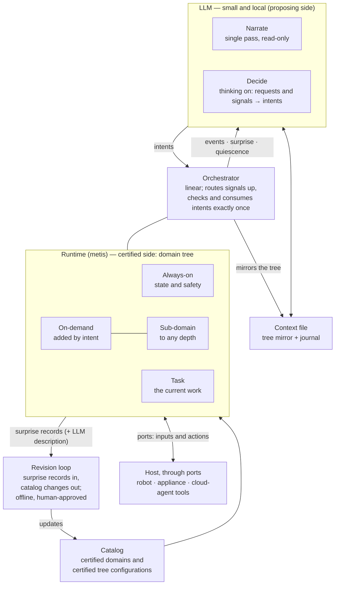

# metis-agent: a small LLM supervising a certified runtime

Oct 10, 2026 · v2 (architect) — rewrite of `System design.md`
(@Chief's seed, kept beside this file as the source), verified
against metis as it stands (metispy e375d9c, metis-lang 8bbfd9d,
metis-loop 50e709c). Companion: `runtime-answers.md` answers the
seed's open questions mechanism by mechanism; this document folds
the answers in and marks every part EXISTS or GAP.

## Vocabulary (replaces the fast/slow framing)

The two-system psychology metaphor is dropped: metis is slow next to
an algorithm and fast next to LLM inference, so "fast/slow" points
at different sides depending on the ruler. The split that matters is
authority, not speed:

- **The certified side** — the metis runtime: owns state, procedure,
  probability and safety; every behavior admitted through gates;
  ~10 ms per evaluation; always on; never waits for the model.
- **The proposing side** — a small local LLM: narrates, maps a
  request to one typed intent, proposes explanations for surprises,
  describes escalations. Fallible by assumption; checked before
  every effect; narrow authority, revocable to zero (observe-only
  never depends on it).

Improvements ship as catalog changes through the revision loop,
never as weights. A deployed device gets smarter without retraining
its model.

## Roles

| Concern | Owner | The LLM's part |
| --- | --- | --- |
| State over a long run | Runtime | Reads a mirror of it |
| Step-by-step procedure | Domain rules | Picks which domain applies |
| Uncertainty | Runtime, exact inference | Puts the result into words |
| Safety and legality | Orchestrator; observe-only on surprise | None; cannot override |
| When to think | Orchestrator signals | Wakes when signalled |
| Changing the rules | Revision loop, offline, human-approved | Describes what went wrong |
| Language and intent | LLM | One typed intent per request |
| Judging a surprise | LLM proposes, runtime checks | Suggests which domain explains it |

## Architecture

The LLM wakes only on orchestrator signals; the runtime never waits
for it. Signals climb the tree and each level may handle them — only
what the orchestrator cannot handle wakes the model. Intents are the
model's sole way to act; each is consumed exactly once or rejected
with a reason.

## One shape, three hosts

| Part | Robot | Cooking machine | Cloud agent |
| --- | --- | --- | --- |
| Always-on domain | Locomotion | Thermal + safety limits | Permissions, spend limits |
| Task domain | Navigation | Recipe progress | The workflow in hand |
| On-demand domains | Grasp, hand over, open a door | Knead, sear, rest | Refund, deploy, triage |
| Ports | Sensors and actuators | Heaters, motors, probes | Tool calls and results |
| Observe-only | Stop acting, keep sensing | Heat off, keep sensing | No writes, keep reading |
| Revision runs with | Fleet engineer | Product team | Operations owner |

The cloud-agent column is the general case: the small model stops
being the agent and supervises one.

## Orchestrator contract

Three signals up, each carrying the raising domain's path; any
ancestor may handle first:

| Signal | Meaning | LLM mode |
| --- | --- | --- |
| Event | Progress or a belief change | Narrate |
| Quiescence | Nothing left the domain can do | Decide, if a goal is pending |
| Surprise | Zero-probability observation; system now observe-only | Decide |

Intents down (starting vocabulary; the orchestrator's signature is
the authority): `activate(domain, bindings)`, `deactivate(domain)`,
`reset(domain)`, `resume(domain)`, `ask(question)`,
`escalate(record)`.

Four rules for any implementation: **typed** (decoded under a
grammar built from the signature), **exactly once** (consumed by one
rule or rejected with a reason that returns as a signal), **checked**
(legality and cost at the orchestrator; an activation is admitted
only if the resulting tree is a certified configuration), **no
deadlines** (a slow or absent model leaves the system observe-only;
safety never depends on a reply).

A metis orchestrator gives exactly-once natively (an intent is a
linear resource) and keeps the LLM-facing surface inside the
certified part. The proven shape exists today: the loop console's
`run_intent` whitelist — one verb set, every call admitted or
refused with a reason, no backdoors. **EXISTS (as pattern).**

## The three cases, verified

**Narration** (trigger: event). Harness updates the mirror; the
model writes a sentence or two; numbers are copied, never generated;
no intent. May lag or drop without touching the runtime. The
narration doctrine (truth rules, beat order, no invention) is
already written and measured in the loop's narrate prompt. **EXISTS
(doctrine + prompt); the mirror renderer is a GAP (small).**

**Requested change** (trigger: user/external request). Decide mode
maps the request to one intent among the offered cards; the
orchestrator admits or rejects; the model relays or asks. Cards are
generated: every catalog already carries `provenance text` (the
one-line purpose) and `extends` (which prunes attachment points
structurally). **EXISTS (card material); grammar-constrained decode
is harness work.**

**Surprise** (trigger: zero-probability observation).

1. Observe-only by rule — no model involved. **GAP: observe-only as
   a runtime/orchestrator state does not exist yet; today surprise
   is a record, not a mode.**
2. The surprise climbs; an ancestor rule may handle it.
3. Otherwise the model wakes with the record and the expanded path.
4. It proposes up to three explanations as intents (reset, or
   activate a different domain, with bindings).
5. **The runtime tests each proposal: a proposal counts only if the
   observation has non-zero probability under it. EXISTS, verbatim:
   `recover(record, program)` scores a stored observation under a
   shadow-admitted candidate (metispy tests/test_record.py), exact,
   STATE_BUDGET-bounded, and since this week it replays under env
   snapshots (`recover(..., plugin=)` + the record's env hash).**
6. Explained → apply and resume. Nothing explains → escalate with
   the model's description and stay observe-only. Same surprise
   after a reset → no more resets, escalate.

The model's description travels on the record as `mined_text` — the
field the revision loop already consumes. **EXISTS.**

Soft surprise: the kernel already grades records `unmodeled`
(likelihood 0 — always wakes) vs `rare` (below `rare_ratio`,
default 0.05 — per-domain knob on the card decides wake vs log).
**EXISTS.**

## Context file

| Region (in order) | Holds | Written by | Lifetime |
| --- | --- | --- | --- |
| Stable prefix | Role, intent grammar, journal rules | Harness | Per deployment |
| Catalog cards | Domains attachable to the current tree | Harness | On tree change |
| Journal | Requests, intents + results, surprises + outcomes | LLM appends and compacts | Rolling |
| Tree mirror | One line per active domain: stage, surprise state, declared beliefs | Harness, from signals | Overwritten in place |
| Inbox | The waking signal or request | Orchestrator or user | One wake |

Properties kept from the seed: activation is an edit; size is
bounded by the tree, not time; depth by path expansion; the
hierarchy prunes the choices. Ordered stable→volatile for prefix
caching. The journal is the only model-written region (the CLM
paper's own 9B results show small models rarely edit unprompted;
steering by skill document first, training later). The CLM reference
code is CC BY-NC 4.0 — it stays out of this tree; the harness is
written fresh.

**Mirror line contents decided:** a domain's declared beliefs are
its catalog's `#query` directives — the marginals the case already
watches. No new syntax; the console band (`ctx` wire) renders the
same material today. **EXISTS (wire); one-line-per-domain renderer
is a GAP (small).**

## What the small LLM has to do

| Task | Mode | Reads | Writes |
| --- | --- | --- | --- |
| Narrate an event | Single pass | One mirror line + the event | A sentence or two |
| Map a request | Thinking | Request + a short card list | One grammar-constrained intent |
| Propose explanations | Thinking | Record + expanded path + cards | Up to three intents |
| Describe for escalation | Single pass | Record + journal | A short paragraph |

Rewriting, classification with slot filling, summarization. No long
reasoning chains; the model never writes LLP. Candidate weights:
Qwen3.5-4B, Gemma 4 E4B (one set of weights, thinking toggled).

## Verification summary: EXISTS vs GAP

Shipped mechanisms the design stands on (pointers are current code):

| Mechanism | Where it exists |
| --- | --- |
| Explanation test (case 3 step 5) | `kernel.record.recover` + shadow-admit; env-aware since metispy 9214991 |
| Surprise grading (hard/soft) | `surprise_record` kinds `unmodeled`/`rare` + `rare_ratio` |
| Escalation description | `mined_text` on the record; the loop mines it |
| Host boundary for a simulated host | PortPlugin (`#plugin`/`--plugin`): `tick()` = inputs as first-class exo rows outside the likelihood, `on_event()` = actions, snapshot/restore keeps counterfactuals honest |
| Exactly-once intent surface (pattern) | loop console `run_intent` whitelist |
| Card material | `provenance text` + `extends` per catalog |
| Mirror material | `#query` marginals, `ctx` wire |
| Narration doctrine | loop narrate prompt (truth/beat/ending rules) |
| Multi-interpreter substrate | the loop bus: N `metis --json` interpreters; blackboard-by-ports parallelism is SPEC §10's decided tier-2 shape |
| Simulated host | Overcooked kitchen: metis-catalog `domains/kitchen` + metispy `domains/kitchen` (model, agent, partner) |
| Revision loop | the whole metis-loop subject flow, running in production this week |

Gaps — the mechanisms the metis line must grow BEFORE the agent
subject starts (the gating list):

| # | Gap | Size | Note |
| --- | --- | --- | --- |
| G-A | Certified tree CONFIGURATIONS as catalog objects (gate in ci) — `activate` selects among them; certificates do not compose today | medium | decided in runtime-answers §1: pre-certify, don't compose, for v1 |
| ~~G-B~~ | ~~The domain TREE at runtime~~ — DROPPED 2026-10-11 (user decision, see *Decisions 2026-10-11*): the hierarchy is formed by independent runtimes wired through ports with an atom/event translation layer, already exercised; the catalog does not model the tree | — | SPEC §10 tier-2 stays the shape of ONE runtime; composition is a wiring concern |
| G-C | Observe-only as a runtime state + `resume` (today surprise is a record, not a mode); whole-tree freeze in v1, subtree later via cone-proved sibling independence | medium | |
| G-D | Outbound signal stream (event/quiescence/surprise pushed to a harness; today the wire is poll/response) | small-medium | |
| G-E | Mirror renderer: one line per domain from `#query` + stage + surprise state | small | |
| G-F | Intent grammar generated from an orchestrator catalog's signature (harness side, GBNF/outlines) | harness | |
| G-G | An orchestrator catalog: intents as linear tokens, signals as produced atoms — the certified `run_intent` | medium | one runtime among the wired ones; no tree support needed |

## Decisions 2026-10-11 (user)

1. **Shape: Go harness ↔ C++ runtime.** The proposing side is the
   existing nina_speak Go node (llama.cpp cgo, two-pass GBNF
   intents, FSTTM floor); the certified side is a runtime in its own
   process, reached through ports. Neither embeds the other.
2. **No LLM-CLM-LL inside a Python layer ("ninapy").** The runtime is
   orthogonal to the harness: it knows nothing about context files,
   journals or intents beyond the port contract. CLM mechanics stay
   harness-side (they already exist in Go).
3. **Hierarchy by composition, not by catalog.** Several independent
   runtimes communicating through ports, with an atom/event
   translation level between them, were already exercised. That
   wiring IS the domain hierarchy. The catalog certifies single
   domains; it does not carry a tree. G-B is dropped; G-A's "tree
   configurations" shrink to "which domains, wired how", a deployment
   artifact rather than a catalog object (to be confirmed when G-A is
   picked up).

## Roadmap 2026-10-11 (user)

The C++ runtime is the **metis kernel with its IR interpreter**; a
**Go adapter** owns the main loop and port handling. The harness is
the nina_speak Go code moved into this repo, in this order (the
engineering design for items 1–3 is `HARNESS.md`):

1. **nina_speak → metis-agent.** Reuse the Go code. Drop the ROS
   module. Keep the FSTTM dialog system (floor management = the wake
   discipline). Narration switches from the phi3 LoRA to the gemma4
   already served by ollama — steadier answers, better cpu/gpu use.
2. **Web interface.** metis-agent is reached through a web UI, built
   as a separate app in metis-loop (websockets; voice in and out).
   The web-UI-relevant parts of `nina_splat` are ported, not
   rewritten.
3. **Regression.** With the nina-agent Go codebase in place: run
   nina-agent voice and chat against the new metis-loop web UI using
   the SAME intents as on the robot. The interface is the carrier, not
   the thing under test.
4. **Context management.** Full port of the Context Language Models
   API (arXiv 2609.37725). The target is a small LLM with long uptime,
   so context cleaning is essential and one consistent way to work
   with the context is worth the port. The reference code is CC BY-NC:
   the API shape is ported, the code is never vendored.

## Build plan (phases unchanged, entry gate added)

Entry gate: G-A, G-C, G-D, G-E closed in the metis line (G-F/G-G land
with phase 1 itself; G-B dropped, see *Decisions 2026-10-11*). Then:

1. **Contract and harness** — orchestrator contract fixed; two LLM
   modes; grammar intents; context file; Overcooked as the host.
   Gate: requests end in an admitted intent or a correct rejection.
2. **Surprise path** — observe-only, explanation test, bounded
   resets, escalation. Inject transient / wrong-domain / novel.
   Gate: no resume without an explaining model; triage beats
   always-escalate.
3. **Long runs** — hours, domains attaching/detaching. Gate: flat
   context size, faithful narration.
4. **Tuning** — skill document evolved with a stronger proposer,
   then a LoRA on logged, orchestrator-labelled data.
5. **Second host** — a cloud agent with real tools.

## Evaluation (kept, one metric added)

Arms A (small LLM alone) / B (+ runtime, no journal) / C (full) /
D (frontier model alone). Measures as in the seed: task success,
illegal actions (zero by construction in B/C), intent validity,
triage accuracy by kind, false resumes (must be zero), narration
faithfulness, wakes/hour + latency, context size over time — plus
**quiet cost**: tokens consumed per hour of uneventful operation
(the architecture's whole bet is that this is near zero).

Stop conditions: B≤A — the premise fails. C≈B — drop the journal;
nothing of CLM remains. Triage ≤ always-escalate — the model stays
narrator and request-mapper only.

## Sources

- `System design.md` (the seed, @Chief, Oct 10 2026) and
  `runtime-answers.md` (architect, same day).
- [Context Language Models, arXiv 2609.37725](https://arxiv.org/pdf/2609.37725) —
  context as a file, 9B editing results, skill-document steering.
- [metis-lang org](https://github.com/metis-lang-dev); Behavior
  Programs as Measures over Proofs, draft 0.3 (zero probability as
  the surprise signal; admission-time certificates).
